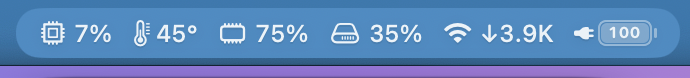
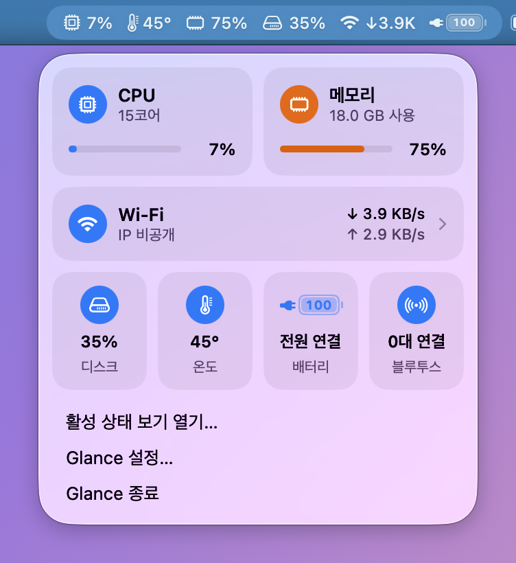
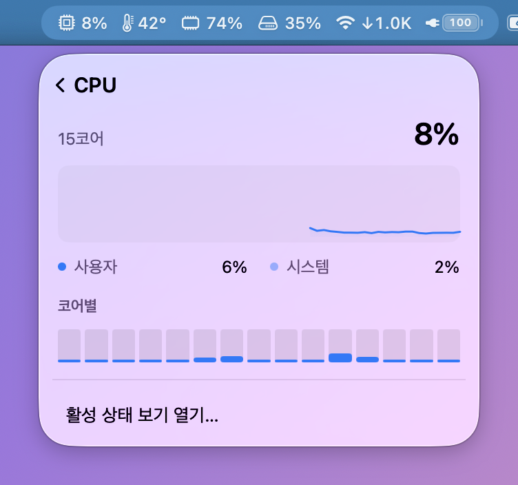
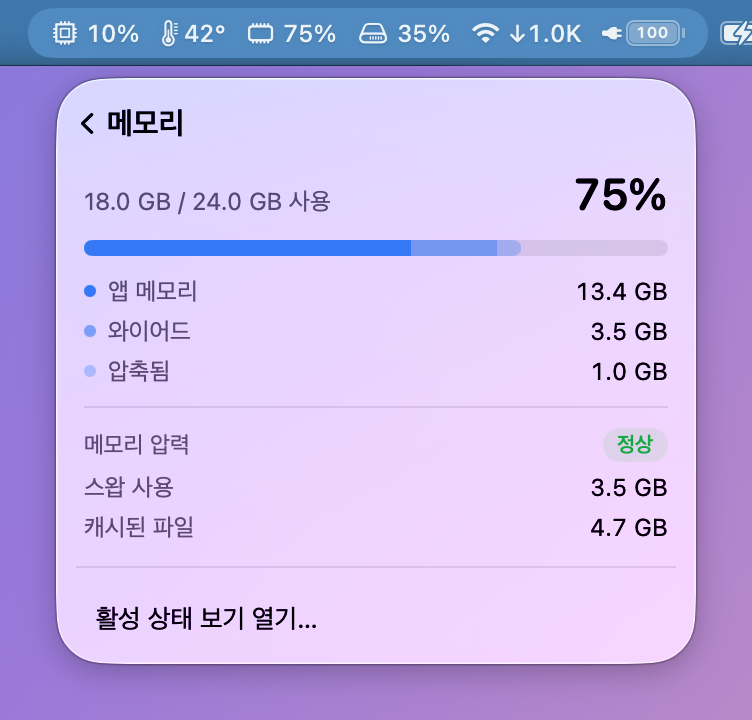
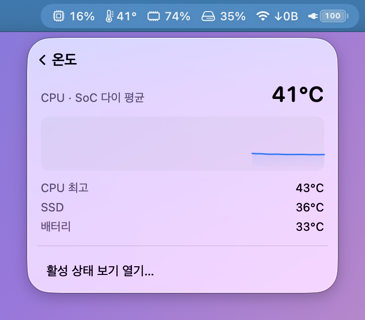
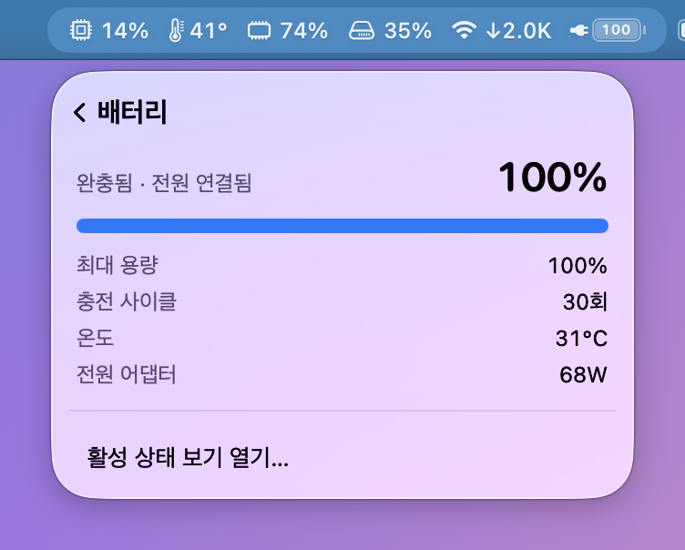
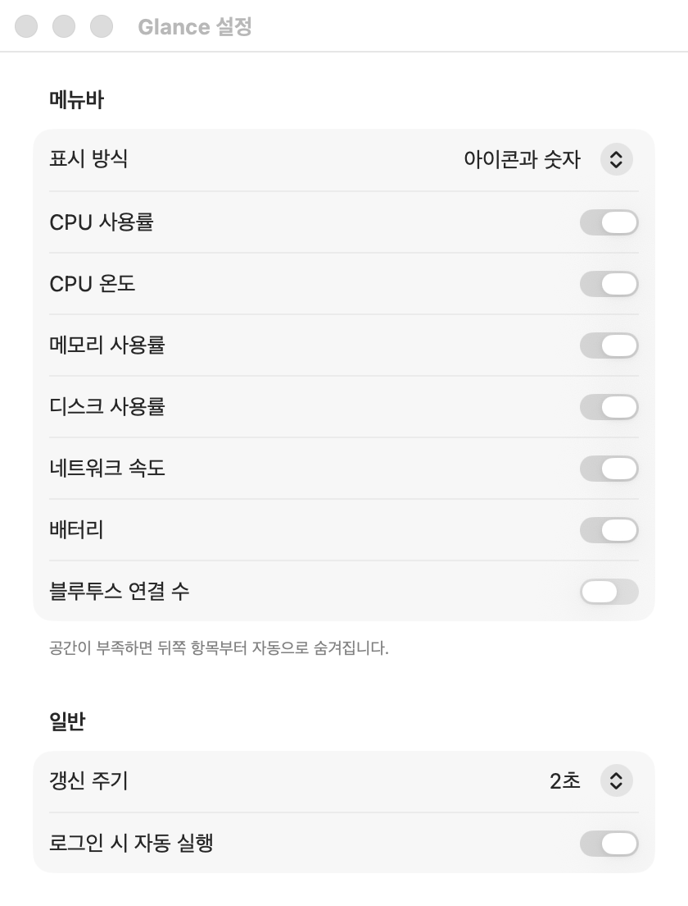

# Glance

> 메뉴바에서 Mac 상태를 한눈에.

macOS 메뉴바에 CPU · 온도 · 메모리 · 디스크 · 네트워크(Wi-Fi/Ethernet) · 배터리 · 블루투스 상태를 보여주는 상주 앱입니다.
Dock 아이콘 없이 메뉴바에만 나타나고, 클릭하면 제어 센터 스타일 패널이 열립니다.



<p>
  
  
</p>

<details>
<summary>더 보기: 메모리 · 온도 · 배터리 · 설정</summary>

<p>
  
  
</p>
<p>
  
  
</p>
</details>

<sub>스크린샷: macOS 26 (Apple M5 Pro). 네트워크 IP는 가림 처리했습니다.</sub>

## 빌드 / 실행

Xcode 없이 Command Line Tools(`swiftc`)만으로 빌드합니다. macOS 14 이상.

```sh
./build.sh            # build/Glance.app 생성
./build.sh run        # 빌드 후 실행
./build.sh install    # ~/Applications 에 설치 후 실행
./build.sh dump       # UI 없이 모든 수집값을 터미널에 출력 (점검용)
```

`build/Glance.app/Contents/MacOS/Glance --snapshot <dir>` 로 메뉴바 라벨과 팝오버를 PNG로 렌더링할 수 있습니다.
`~/Applications/Glance.app/Contents/MacOS/Glance --login-item on|off|status` 로 터미널에서 로그인 시 자동 실행을 켜고 끌 수 있습니다.

## 표시 항목

| 항목 | 내용 | 데이터 출처 |
|---|---|---|
| CPU | 전체/사용자/시스템 사용률, 코어별 막대, 60샘플 그래프 | `host_processor_info` |
| CPU 온도 | SoC 다이 센서 평균/최고, SSD 온도 | IOKit HID 온도 센서 (비공개 심볼을 런타임에 로드, 루트 권한 불필요) |
| 메모리 | 사용량(앱+와이어드+압축, 활성 상태 보기와 동일 기준), 메모리 압력, 스왑 | `host_statistics64`, `sysctl` |
| 디스크 | 내장/외장 볼륨 사용량, 읽기/쓰기 속도 | `URLResourceValues`, IOKit `IOBlockStorageDriver` |
| 네트워크 | 전체 ↓/↑ 속도 그래프, Wi-Fi(SSID·신호·채널·대역·규격·전송속도·IP), 연결된 Ethernet(링크 속도·IP) | `sysctl NET_RT_IFLIST2`(64비트 카운터), SystemConfiguration, CoreWLAN |
| 배터리 | 잔량, 충전 상태, 남은 시간, 성능(최대 용량), 사이클, 배터리 온도, 충·방전 W, 어댑터 W | `IOPowerSources`, `AppleSmartBattery` |
| 블루투스 | 전원 상태, 연결된 기기와 배터리(AirPods L/R/케이스 포함), 페어링 기기 목록 | `system_profiler SPBluetoothDataType -json` (10초 주기, 별도 권한 불필요) |

## 화면 구성

- **패널**: 메뉴바 아이콘을 누르면 아이콘 바로 아래에 제어 센터 스타일 패널이 열립니다 (macOS 26은 Liquid Glass, 이전 버전은 반투명 재질).
  - 큰 모듈: CPU · 메모리 / 넓은 모듈: 네트워크 / 작은 모듈: 디스크 · 온도 · 배터리 · 블루투스
  - 모듈을 누르면 상세 페이지로 전환, `‹` 또는 Esc로 돌아오기. 긴 목록은 화면 높이에 맞춰 스크롤
  - 바깥 클릭 · 다른 앱 전환 · Esc로 닫힘
- **메뉴바 표시 방식**: 아이콘만 / 아이콘과 숫자 / 두 줄 상세. 노치에 걸리면 뒤쪽 항목부터 자동으로 숨김

## 설정 (패널 하단 "Glance 설정…")

- 메뉴바 표시 방식과 표시 항목
- 갱신 주기 1 / 2 / 5초 (기본 2초)
- 로그인 시 자동 실행

## 참고

- **CPU 온도**: Apple Silicon에는 공개 온도 API가 없어 Stats·powermetrics와 같은 HID 센서를 읽습니다. 표시값은 SoC 다이(CPU/GPU 클러스터) 센서의 평균·최고값입니다. 향후 macOS에서 센서가 바뀌면 온도 줄이 자동으로 숨겨집니다.
- 배터리가 없는 Mac(데스크톱)에서는 배터리 섹션이 표시되지 않습니다.
- **Wi-Fi 이름(SSID)**: macOS 14부터 위치 권한이 있어야 SSID를 알려줍니다. 팝오버의 "SSID 표시하기" 링크로 권한을 요청할 수 있고, 위치 정보 자체는 사용하지 않습니다.
- 앱은 ad-hoc 서명입니다. 다시 빌드하면 서명이 바뀌어 위치 권한을 다시 요청할 수 있습니다.
- 평소 점유: CPU 약 1%, 메모리 약 55MB (2초 주기 기준).

## 개발용 환경변수

| 변수 | 용도 |
|---|---|
| `RM_DEBUG=1` | 메뉴바 노치 배치 · 패널 열기/닫기 로그 |
| `RM_DEBUG_OPEN_PANEL=1` 또는 `=cpu` 등 | 실행 후 패널을 자동으로 열기 (상세 페이지 지정 가능) |
| `RM_DEBUG_OPEN_DELAY=<초>` | 위 자동 열기까지 대기 시간 (그래프 기록을 채울 때) |
| `RM_DEBUG_OPEN_SETTINGS=1` | 실행 후 설정 창 열기 |
| `RM_DEBUG_BACKDROP=1` | 패널 뒤에 그라데이션 배경 창 (스크린샷에 다른 앱 내용이 비치지 않게) |
| `RM_PRIVACY=1` | Wi-Fi 이름 · IP 가리기 |
| `RM_DEBUG_MAX_HEIGHT=<pt>` | 화면 높이가 작은 상황 재현 (상세 페이지 스크롤 확인) |
| `RM_DEBUG_NOTCH_MAX_X=<x>` | 노치 위치를 가정해 메뉴바 자동 축소 확인 |

